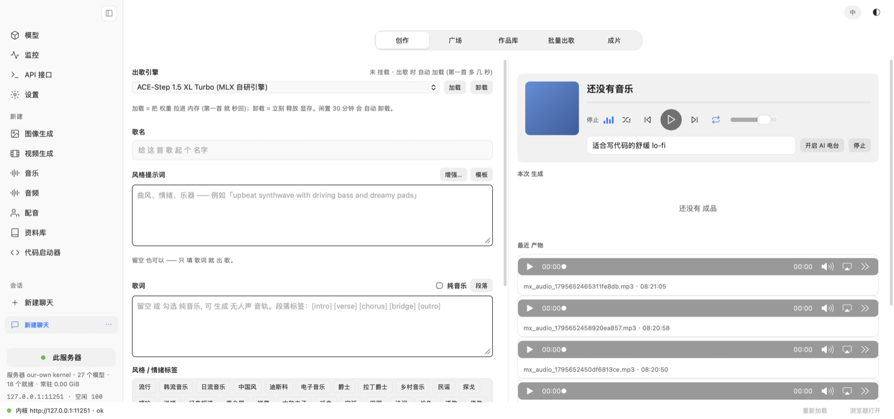
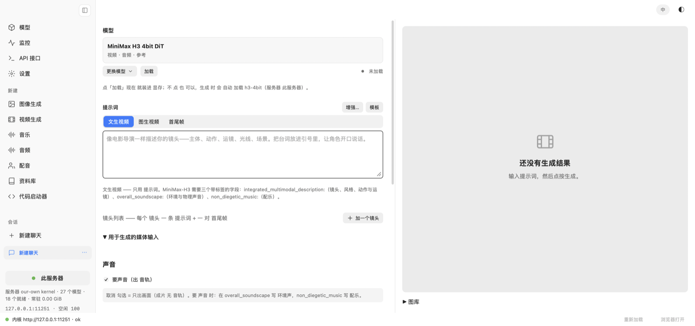
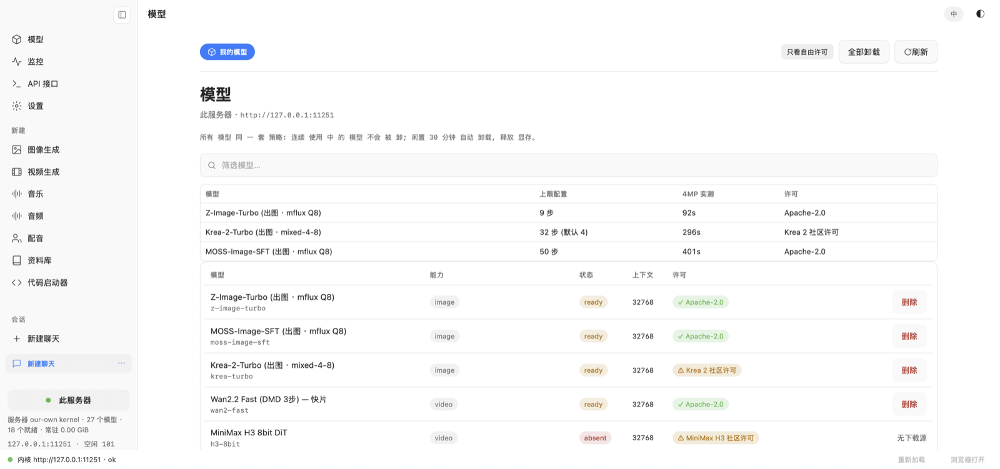

# MLX Studio

[](https://github.com/phoenix7956/mlx-studio/releases/latest)
[](LICENSE)


[中文](README.md) | English

**An AI creation studio that runs on your own Mac.** Images, video, music, speech and chat in
one desktop app. Every model runs locally — nothing is uploaded.

Clean-room implementation. No closed-source app required. MIT licensed.

---

## Screens

**Music workbench** — load/unload the song engine, style tags, lyric sections, plaza, works
library and batch generation all live on this one page:



**Video generation** — text-to-video / image-to-video / first-and-last-frame. A shot list
(one prompt plus a pair of keyframes per shot), and a "with sound" toggle that adds a real
audio track to the finished clip:



**Models** — every weight carries a licence badge, and you can filter down to
"free licences only". Model rows only offer *download* and *delete*; loading and unloading
happen in the project page that actually uses them:



---

## What it does

Twelve pages, one app:

| Page | What it does |
|---|---|
| **Models** | See which models are installed, download them, delete them. Each row carries a licence badge, with a one-click "free licences only" filter. Load/unload happens in the project page once a model is in use |
| **Image** | Text-to-image, image-to-image, SDEdit, reference-image weighting, RGBA. Krea-2-Turbo / Z-Image-Turbo / MOSS-Image-SFT |
| **Video** | Text-to-video, image-to-video, first-and-last-frame. H3 (with audio) / Wan2.2. Batch runs over keyframe pairs |
| **Music** | Song workbench: local ACE-Step generation (30 s of song in ~2.3 s), style tags, lyrics, batch, plaza, works library |
| **Audio** | Speech synthesis, sound effects, voice cloning |
| **Dubbing** | Voice library, clone a new voice (auto transcription + a preview clip), batch dubbing, lay it back onto video, keep the original audio |
| **Chat** | Local LLM chat with a thinking toggle and streaming output |
| **Library** | Everything you have produced |
| **Monitor** | Engine state, memory, unloading |
| **API** | Every capability also has an HTTP endpoint |
| **Settings / Code Launcher** | Parameters, batch scripts |

All output lands in `~/Documents/MLX Studio 输出/{音频,图片,视频,语音,3D}/`.

## Install

Requires **macOS on Apple Silicon** (M-series).

### Option 1 — download the installer (recommended)

Grab the `.dmg` from [Releases](https://github.com/phoenix7956/mlx-studio/releases/latest) and
drag it into Applications.

### Option 2 — from source

```bash
git clone https://github.com/phoenix7956/mlx-studio.git
cd mlx-studio
./install.sh
```

Afterwards:

- The kernel listens on `http://127.0.0.1:11251` and starts at login (launchd `com.ours.mlxstudio`)
- The desktop app is installed to `/Applications/MLX Serve Studio.app`
- **Model weights are not shipped** — open the Models page and hit Download, or pull them yourself

Useful flags:

```bash
./install.sh --no-agent   # don't register a login item, run once
./install.sh --no-ace     # skip the large music-engine environment (~2 GB saved)
./install.sh --app        # only install the desktop app
./install.sh --port 11251 # use a different port
./clean.sh                # purge temp output and stale caches
```

## Model weights and licences

**This repository contains no model weights.** Engine code and model weights are two different
things:

- **Engine code** is in this repo; its licence is listed under [Licence](#licence).
- **Model weights** are downloaded by you from the Models page and carry **their authors' own
  licences**, independently of this project. Download MiniMax-H3 and you accept MiniMax's
  community licence; download Krea-2 and you accept Krea's community licence; Wan2.2, Z-Image
  and MOSS-Image are Apache-2.0, so use them as Apache-2.0.

This project takes no responsibility for which models you run or how you commercialise them,
and it never accepts a licence on your behalf — that agreement is between you and the model's
author.

The Models page shows the licence of each weight:

- **✓ Apache-2.0 / MIT / built-in** — free licence, use it however you like, commercially included
- **⚠ Community licence** — extra terms (revenue thresholds / attribution / regional limits);
  read the original before using commercially

"Free licences only" in the top right filters out the ⚠ ones. **Everything is shown by default**;
free licences are simply listed first.

Downloads go through **ModelScope** by default (fast inside China), with hf-mirror as fallback.

> 📄 **Read [`docs/开源说明.md`](docs/开源说明.md) first** — what this repo does and does not
> contain, how to configure the API key, how to add a second machine, how licences work.

## HTTP API

The kernel is a plain HTTP service — the UI is just another client, and so is your script.

```bash
curl http://127.0.0.1:11251/v1/models   # model list + load state
curl http://127.0.0.1:11251/health
```

Main endpoints:

| Capability | Endpoint |
|---|---|
| Image generation | `POST /v1/images/generations` |
| Video generation | `POST /v1/videos/generations` |
| Music generation | `POST /v1/audio/music-generations`, `POST /v1/music/generate` |
| Speech synthesis | `POST /v1/audio/speech` |
| Voice cloning / dubbing | `POST /v1/voices/clone`, `POST /v1/voices/dub` |
| Chat | `POST /v1/chat/completions` |

The full parameter surface lives in `api_full.py`; the contract regression suite is
`smoke_contract.py` (37 checks).

## Layout

```
server.py            HTTP service: routing, model load state, metrics, media SSE
api_full.py          parameter surface for every /v1/* endpoint
cap_engines.py       capability engines (embeddings / TTS / SFX / music / 3D / image / video / ASR …)
image_engine.py      Krea-2-Turbo wrapper
image_advanced.py    latent blending, true CFG, Otsu feathering, colour transfer
music_workbench.py   song workbench backend
music_engine.py      ACE-Step song generation
voice_studio.py      dubbing workbench (voice library / cloning / batch)
llm_engine.py        local LLM wrapper
voice_convert.py     voice conversion (YIN + PSOLA + spectral-envelope transfer)
engine.py            inference glue
ui/console.html      the UI (single file)

desktop/             macOS desktop app source (Swift + AppKit + WKWebView)
vendor/              third-party engine sources (each with its own LICENSE / NOTICE)
vendor_src/          mlx-video (MIT)
ace-step-engine/     ACE-Step song engine (MIT)
port_minimax_h3_mlx/ H3 engine patches
port_wan2_mlx/       Wan2.2 engine
install.sh           one-shot installer
desktop/package.sh   build the DMG / ZIP installer
docs/                internal ops docs
smoke_*.py           regression tests
```

## Licence

This project is **MIT** (see `LICENSE`).

Third-party code keeps its own licence — see [`THIRD_PARTY_NOTICES.md`](THIRD_PARTY_NOTICES.md):

| Component | Licence |
|---|---|
| `vendor/minimax-h3_mlx_src/` | Apache-2.0 (upstream PipeNetwork/minimax-h3-mlx) |
| `vendor/krea2_engine_src/` | Krea 2 Community Licence (upstream avlp12/krea2_alis_mlx) |
| `vendor_src/mlx_video/` | MIT (Prince Canuma) |
| `ace-step-engine/` | MIT (ACEStep / Fabrizio Salmi) + nano-vllm's MIT |

The two directories under `vendor/` ship their own `LICENSE` and `NOTICE`, listing every file
we modified.

## Independent implementation

MLX Studio is a clean-room implementation written from scratch. The repository contains **no**
code, resources or binaries from any closed-source app, and at runtime it never reads any file
belonging to one. The features and interactions were re-implemented from publicly observable
behaviour.

## Development

```bash
python3 -m venv ~/.venvs/mlxstudio
~/.venvs/mlxstudio/bin/pip install -r requirements.txt
~/.venvs/mlxstudio/bin/python server.py --port 11251
```

Regression:

```bash
~/.venvs/mlxstudio/bin/python smoke_contract.py    http://127.0.0.1:11251
~/.venvs/mlxstudio/bin/python smoke_capabilities.py http://127.0.0.1:11251
```

Pre-commit checks (CI runs the same):

```bash
python3 tools/check_catalog.py
bash -n install.sh && bash -n clean.sh
python3 -m compileall -q .
```

See [`CONTRIBUTING.md`](CONTRIBUTING.md) to contribute,
[`SECURITY.md`](SECURITY.md) to report a vulnerability, and
[`docs/开源说明.md`](docs/开源说明.md) for repo boundaries, API keys and adding a second machine.
