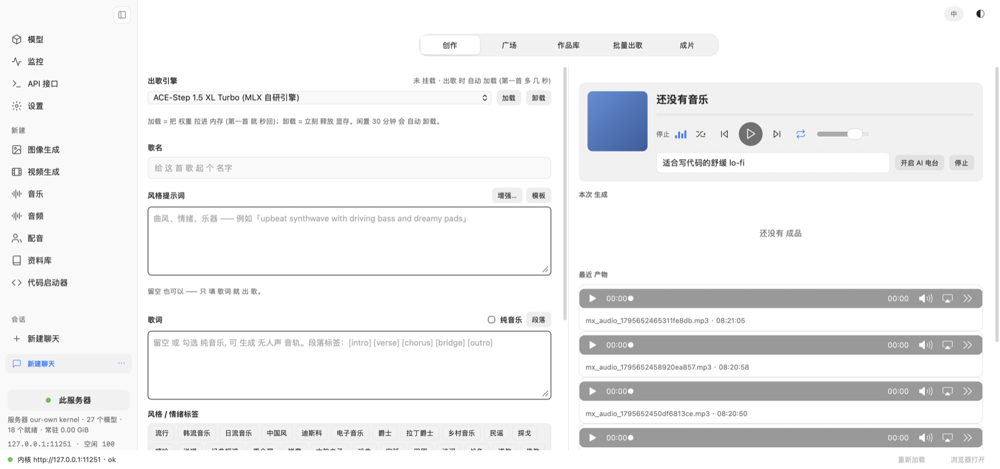
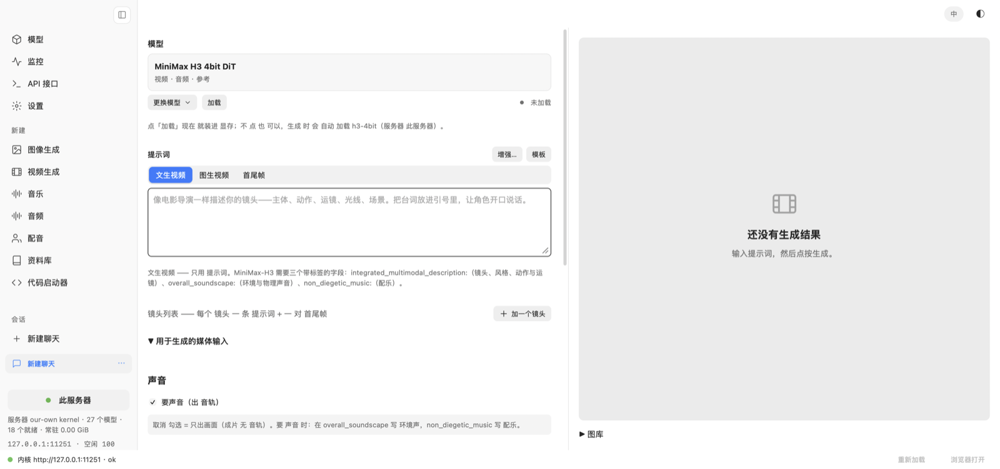
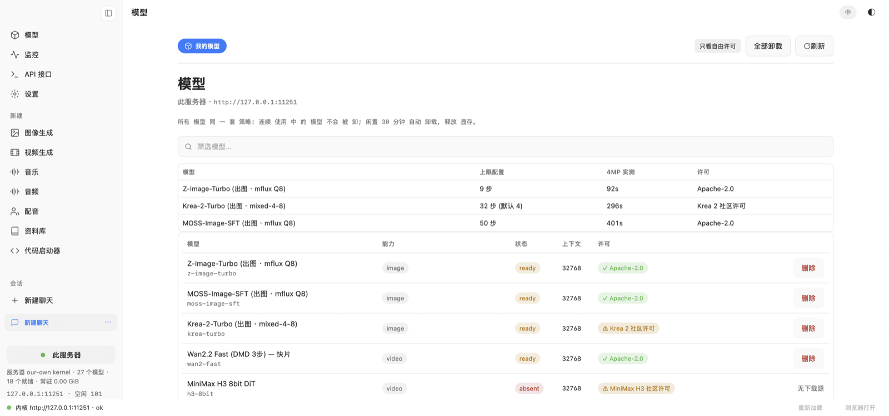

# MLX Studio

[](https://github.com/phoenix7956/mlx-studio/releases/latest)
[](LICENSE)

[](https://github.com/phoenix7956/mlx-studio/actions/workflows/ci.yml)

[中文](README.md) | English

**跑在你自己 Mac 上的 AI 创作工作室。** 图像、视频、音乐、语音、对话，一个桌面 App 全包，
模型权重全部本地跑，不上传任何数据。

独立实现，不依赖任何闭源 App。Apache-2.0 许可，允许商业使用。

---

## 界面

**音乐工作台** —— 出歌引擎可加载 / 卸载，风格标签、歌词段落、广场、作品库、批量出歌都在这一页：



**视频生成** —— 文生视频 / 图生视频 / 首尾帧三选一，镜头列表（每镜一条提示词 + 一对首尾帧），
「要声音」勾上就出带音轨的成片：



**模型页** —— 每个权重都带许可徽章，能一键筛「只看自由许可」；模型行只有「下载 / 删除」，
加载卸载在各自的项目页里做：



---

## 它能干什么

12 个页面，一个 App：

| 页 | 能做什么 |
|---|---|
| **模型** | 看本机装了什么模型、下载、删除。每一行 带 许可 徽章，可一键「只看自由许可」。模型跑起来后在项目页加载 / 卸载 |
| **图像** | 文生图、图生图、SDEdit、参考图加权、RGBA。Krea-2-Turbo / Z-Image-Turbo / MOSS-Image-SFT |
| **视频** | 文生视频、图生视频、首尾帧。H3（带声音）/ Wan2.2。批量首尾帧跑批 |
| **音乐** | 出歌工作台：ACE-Step 本地出歌（30 秒 ≈ 2.3 秒）、风格标签、歌词、批量、广场、作品库 |
| **音频** | 语音合成、音效、语音克隆 |
| **配音** | 音色库、克隆新音色（自动转写 + 出试听样音）、批量配音、贴回视频、保留原声 |
| **对话** | 本地 LLM 聊天，带思考开关和流式输出 |
| **资料库** | 产物管理 |
| **监控** | 引擎状态、显存、卸载 |
| **API** | 所有能力都有 HTTP 端点 |
| **设置 / 代码启动器** | 参数、跑批脚本 |

产物统一落在 `~/Documents/MLX Studio 输出/{音频,图片,视频,语音,3D}/`。

## 安装

要求：**macOS + Apple Silicon**（M 系列芯片）。

### 方式一：下载安装包（推荐）

去 [Releases](https://github.com/phoenix7956/mlx-studio/releases/latest) 下 `.dmg`，拖进「应用程序」。

### 方式二：从源码装

```bash
git clone https://github.com/phoenix7956/mlx-studio.git
cd mlx-studio
./install.sh
```

装完：

- 内核跑在 `http://127.0.0.1:11251`，开机自启（launchd `com.ours.mlxstudio`）
- 桌面 App 装到 `/Applications/MLX Serve Studio.app`
- **模型权重不随安装包分发** —— 打开「模型」页点「下载」，或者用界面选好参数自己下

常用参数：

```bash
./install.sh --no-agent   # 不装开机自启，只跑一次
./install.sh --no-ace     # 不装出歌引擎的大环境（省 ~2GB）
./install.sh --app        # 只装桌面 App
./install.sh --port 11251 # 换端口
./clean.sh                # 清临时产物和旧缓存
```

## 模型权重与许可

**这个仓库不包含任何模型权重。** 引擎代码和权重是两回事：

- **引擎代码**在仓库里，许可见下面的「许可」一节。
- **模型权重**由你在「模型」页下载，**各自遵循模型作者自己的许可**，跟本项目无关。
  你下载 MiniMax-H3 就接受 MiniMax 的社区许可，下载 Krea-2 就接受 Krea 的社区许可，
  下载 Wan2.2 / Z-Image / MOSS-Image 这些 Apache-2.0 的就按 Apache-2.0 用。

本项目不对你用哪个模型、怎么商用负责，也不替你接受任何协议 —— 那是你和模型作者之间的事。

界面「模型」页会显示每个权重的许可类型：

- **✓ Apache-2.0 / MIT / 内置** —— 自由许可，随便用，商用也可以
- **⚠ 社区许可** —— 有附加条款（营收门槛 / 署名 / 地区限制等），商用前自己看原文

点右上角「只看自由许可」可以把 ⚠ 的那些筛掉。**默认全部显示**，只是自由许可的排在前面。

下载默认走 **魔搭**（国内最快），hf-mirror 自动兜底。

> 📄 **第一次用请先看 [`docs/开源说明.md`](docs/开源说明.md)** —— 仓库里有什么、没有什么、
> 密钥怎么配、第二台机怎么接、许可怎么算。

## HTTP API

内核是一套标准 HTTP 服务，界面用的就是它，脚本也能直接调。

```bash
curl http://127.0.0.1:11251/v1/models   # 模型列表 + 装载态
curl http://127.0.0.1:11251/health
```

主要端点：

| 能力 | 端点 |
|---|---|
| 图像生成 | `POST /v1/images/generations` |
| 视频生成 | `POST /v1/video/generations` |
| 批量出片（首尾帧 / 图生视频） | `POST /v1/video/batch` |
| MV 工作台（多镜头 + 配乐 + 合并） | `POST /v1/video/mv` |
| 音乐生成 | `POST /v1/audio/music-generations`、`POST /v1/music/generate` |
| 语音合成 | `POST /v1/audio/speech` |
| 音色克隆 / 合成 / 批量配音 | `POST /v1/voices`、`POST /v1/voices/speak`、`POST /v1/voices/dub` |
| 对话 | `POST /v1/chat/completions` |

完整参数面见 `api_full.py`，契约回归见 `smoke_contract.py`（37 条）。

## 接入 Agent（MCP）

装完就能挂 —— Codex、Claude Code、Cursor、Gemini CLI、OpenCode 都支持 MCP，
Studio 自带一个 **MCP server**，让 agent 直接调本机的出图 / 出片 / 出歌。

```bash
./install.sh          # 装 完 自动 把 Studio 挂 到 本机 已装 的 agent 上
~/.ours/bin/mlx-mcp --check    # 看 挂 上 没 / 内核 在 不 在
```

挂上之后 agent 里会多一组 `mlx-studio` 工具：

| 工具 | 干什么 |
|---|---|
| `studio_status` | 内核状态、出片走本机还是远端、剩多少内存 |
| `list_models` / `load_model` / `unload_model` | 模型清单、加载、卸载 |
| `list_output_images` / `list_output_audio` / `list_outputs` | 翻产物、挑首尾帧素材、挑配乐 |
| `submit_image` / `submit_music` / `submit_video_batch` / `submit_mv` | 提交生成任务 |
| `job_status` | 查任务进度 |

出图要几分钟、出片更久，所以这些都做成 **异步**：提交完返回一个 `job_id`，
过一会儿用 `job_status` 查。任务跑在独立进程里，**agent 中途退出也不会打断**。

想手动接：

```bash
python3 tools/register_mcp.py --print   # 打印 手抄 版 配置
python3 tools/register_mcp.py --check   # 看 状态
python3 tools/register_mcp.py --remove  # 摘掉
```

细节见 [docs/Agent接入.md](docs/Agent接入.md)。

## 目录结构

```
server.py            HTTP 服务：路由分发、模型装载态、指标、媒体 SSE
api_full.py          所有 /v1/* 端点的参数面
cap_engines.py       能力引擎（向量 / TTS / 音效 / 音乐 / 3D / 图像 / 视频 / ASR …）
image_engine.py      Krea-2-Turbo 封装
image_advanced.py    潜变量混合、真 CFG、Otsu 羽化、色彩迁移
music_workbench.py   出歌工作台服务端
music_engine.py      ACE-Step 出歌
voice_studio.py      配音工作台（音色库 / 克隆 / 批量）
llm_engine.py        本地 LLM 封装
voice_convert.py     音色迁移（YIN + PSOLA + 倒谱共振峰包络）
engine.py            推理胶水
ui/console.html      界面前端（单文件）

desktop/             macOS 桌面 App 源码（Swift + AppKit + WKWebView）
vendor/              第三方引擎源码（各自带自己的 LICENSE / NOTICE）
vendor_src/          mlx-video（MIT）
ace-step-engine/     ACE-Step 出歌引擎（MIT）
port_minimax_h3_mlx/ H3 引擎补丁
port_wan2_mlx/       Wan2.2 引擎
install.sh           一键安装
desktop/package.sh   打成 DMG / ZIP 安装包
docs/                内部运维文档
smoke_*.py           回归测试
```

## 许可

本项目采用 **Apache License 2.0**（见 [`LICENSE`](LICENSE)），**允许商业使用**：
可自由使用、复制、修改、合并、发布、分发、再授权和销售，商用**不需要**额外授权或付费。

相比 MIT，Apache-2.0 额外提供**明确的专利授权**：贡献者授予永久性的、全球性的专利许可，
覆盖其贡献部分——这能降低被第三方专利诉讼打断的风险，是我们选它的唯一实质理由。

本项目**不含任何禁止商用的条款**。你要做的只有两件事：

1. 保留版权声明与许可原文（Apache-2.0 §4）；
2. 随分发附带 [`NOTICE`](NOTICE)。

> ⚠️ **商标不在授权范围内。** 「MLX Studio」这个名称和 Logo 归项目方所有，
> Apache-2.0 只授权代码使用。第三方名称与商标（Apple、Apple Silicon、MLX、MiniMax、
> Krea、ACE-Step 等）归各自权利人所有，这里仅用于标识兼容性。

第三方代码各自独立授权，见 [`THIRD_PARTY_NOTICES.md`](THIRD_PARTY_NOTICES.md)：

| 组件 | 许可 |
|---|---|
| `vendor/minimax-h3_mlx_src/` | Apache-2.0（上游 PipeNetwork/minimax-h3-mlx） |
| `vendor/krea2_engine_src/` | Krea 2 Community License（上游 avlp12/krea2_alis_mlx） |
| `vendor_src/mlx_video/` | MIT（Prince Canuma） |
| `ace-step-engine/` | MIT（ACEStep / Fabrizio Salmi）+ nano-vllm 的 MIT |

`vendor/` 下的两个目录带自己的 `LICENSE` 和 `NOTICE`，改动过的文件在里面列明了。

**模型权重不在本仓库内**，由使用者自行从上游下载，遵循各自上游协议，
与本项目代码的许可相互独立。逐个模型的权重许可见
[`THIRD_PARTY_NOTICES.md`](THIRD_PARTY_NOTICES.md) 的权重许可表。

## 独立实现声明

MLX Studio 是从零写的 clean-room 实现。仓库里**没有**任何闭源 App 的代码、资源或二进制，
运行时也不读取闭源 App 的任何文件。界面的功能与交互是按公开可观察的行为重新实现的。

## 开发

```bash
python3 -m venv ~/.venvs/mlxstudio
~/.venvs/mlxstudio/bin/pip install -r requirements.txt
~/.venvs/mlxstudio/bin/python server.py --port 11251
```

回归：

```bash
~/.venvs/mlxstudio/bin/python smoke_contract.py    http://127.0.0.1:11251
~/.venvs/mlxstudio/bin/python smoke_capabilities.py http://127.0.0.1:11251
```

提交前 自检（CI 也 跑 这 几 条）：

```bash
python3 tools/check_catalog.py
bash -n install.sh && bash -n clean.sh
python3 -m compileall -q .
```

参与开发 看 [`CONTRIBUTING.md`](CONTRIBUTING.md)；
报 漏洞 看 [`SECURITY.md`](SECURITY.md)；
仓库 边界 / 密钥 / 第二台机 怎么 接 看 [`docs/开源说明.md`](docs/开源说明.md)。

